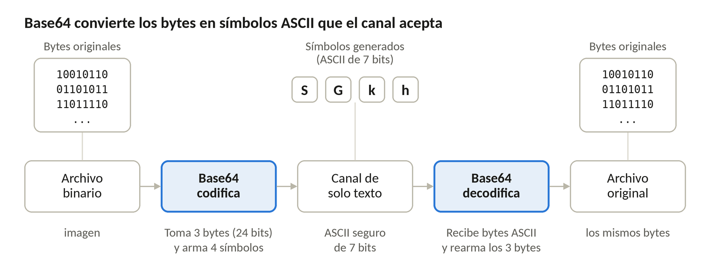
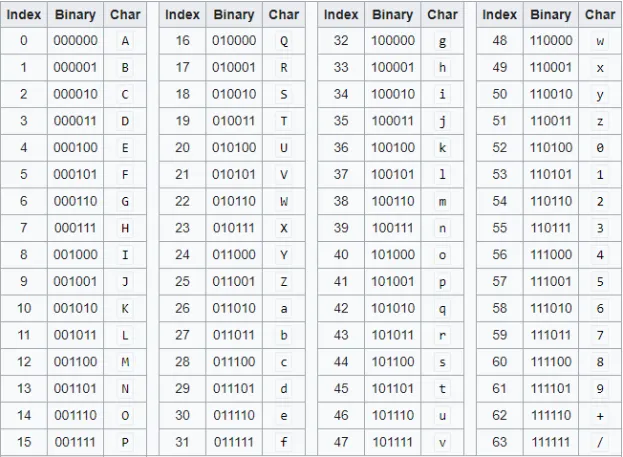
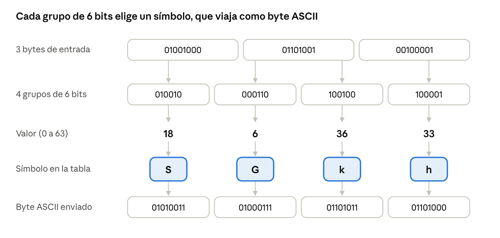
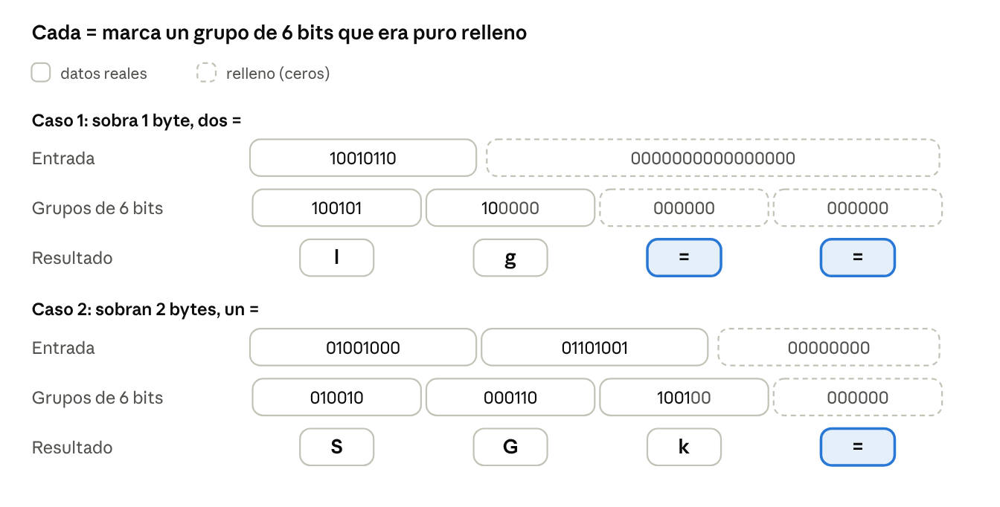

# Base64: qué problema resuelve y cómo funciona

**Índice**

- [Qué es un sistema de codificación](#sec-encoding-systems)
- [Contexto histórico: limitaciones de la época y origen de Base64](#sec-history)
- [La solución: Base64](#sec-solution)
    - [Cómo codifica Base64](#sec-how-it-encodes)
    - [Por qué funciona: qué es lo que realmente se transmite](#sec-why-it-works)
    - [Cómo codificar una secuencia no múltiplo de 3](#sec-non-multiple-of-3)
    - [Cómo decodifica Base64](#sec-how-it-decodes)
- [Relevancia en seguridad](#sec-security)
- [Fuentes](#sources)

## Qué es un sistema de codificación

Cuando representamos caracteres, letras, íconos, etcétera, los sistemas informáticos utilizan un sistema de codificación. Un sistema de codificación es un estándar que define una cantidad específica de caracteres o íconos, a cada uno de los cuales se le asigna un valor propio: un número en decimal que tiene su conversión a binario. En la práctica, es una tabla con un valor binario/decimal y el carácter que representa.

Normalmente, y a excepción de casos como Unicode, los sistemas de codificación están limitados por la cantidad de bits que utilizan para representar cada carácter. Esto define cuánto espacio va a ocupar cada carácter al momento de enviarse. ASCII, por ejemplo, usa 7 bits para representar un carácter, lo que da 2⁷ combinaciones posibles, es decir, 128 caracteres posibles. ASCII extendido, en cambio, usa un byte entero para representar un carácter, es decir, 2⁸ combinaciones posibles, o sea, 256 caracteres posibles.

Cuando enviamos un carácter por un sistema informático, lo que en realidad se envía es la secuencia de bits (la secuencia de bytes) que corresponde a ese carácter. Esos números binarios, unos y ceros, son los que viajan. Del otro lado, quien recibe esa información la reinterpreta según su propio sistema de codificación: toma esos valores binarios, los convierte a su equivalente en decimal y busca en la tabla del sistema de codificación (en la que ambas partes están de acuerdo para poder comunicarse) qué carácter le corresponde a ese número. Por esa misma razón, un mismo valor binario puede representar caracteres completamente diferentes, dependiendo de qué sistema de codificación esté usando quien lo interpreta.

## Contexto histórico: limitaciones de la época y origen de Base64

En la época en que se inventó Base64 se usaba normalmente ASCII, el que no era extendido. ASCII ocupaba un espacio de 128 caracteres posibles, de los cuales solo una parte eran imprimibles, y esos pocos eran los básicos: las letras del alfabeto inglés, los números del 0 al 9 y poco más. En el byte que enviaban los equipos informáticos, se usaban los primeros 7 bits para describir el carácter, y el octavo, dependiendo del sistema, se usaba para control de errores o directamente se descartaba.

Más adelante se empezó a necesitar más caracteres, porque ASCII estaba muy limitado a caracteres en inglés y a pocos símbolos. Por esa razón se empezó a utilizar el octavo bit para enviar información, dando lugar a ASCII extendido: una tabla de 256 caracteres posibles, a razón de un byte por carácter, que iba del 0 al 255. El problema es que ASCII extendido usaba los primeros 128 valores para lo que ya estaba en ASCII y dejaba los restantes a criterio de cada empresa que lo implementara, que podía ocuparlos como quisiera.

Esto significaba que los primeros 7 bits se usaban como siempre, y el octavo cada empresa lo usaba a su manera, en el rango de 128 a 255. Algunas priorizaban caracteres para dibujar (bordes y líneas), otras símbolos y letras árabes, otras griegas, otras latinas, etcétera. Cada empresa tenía su propia definición de lo que era ASCII extendido, su propia tabla, con una interoperabilidad nula entre ellas. Esto deriva directamente de lo explicado antes: si el receptor de los bytes interpreta el mensaje con un sistema de codificación diferente al que usó quien lo envió, el mensaje resultante es completamente distinto.

Esto traía a colación un **segundo problema, aún más importante**. Aunque todas estas empresas se hubieran puesto de acuerdo y usado un único ASCII extendido, el problema de fondo seguía estando en los propios sistemas informáticos, que esperaban recibir específicamente una secuencia de 7 bits por cada carácter, usando el octavo para control de errores o directamente por fuera de esa representación. Entonces, cuando se intentaba enviar algo que no fuera texto (un binario, una imagen, un ejecutable; datos que no son legibles sino información interpretada por un programa), esos datos terminaban totalmente deformados o destruidos en el camino, porque no se garantizaba que el byte completo llegara intacto al final. A veces el octavo bit se corrompía porque se interpretaba como un código de error; a veces directamente se descartaba.

De todo esto surgieron dos problemas principales. El primero era cómo estandarizar qué carácter significa cada número: el caos de las diversas tablas de ASCII extendido hacía que un mensaje enviado desde un sistema de codificación llegara deformado a otro que lo reinterpretaba según una tabla distinta. Esto, años después, se resolvió con Unicode, que usa diversos formatos de codificación (UTF-8, UTF-16, UTF-32, etc.). Pero es un problema completamente aparte del que nos compete.

El segundo, y el principal, era: **¿cómo podemos enviar imágenes o ejecutables, archivos binarios que no son texto plano ni texto legible, a través de un sistema que únicamente acepta caracteres de texto plano y, específicamente, de 7 bits?**

El caso más conocido de esta limitación era el correo electrónico. El protocolo SMTP asumía que la información era texto de 7 bits, con un octavo bit reservado para control de errores o directamente descartado. Por eso, al adjuntar una imagen, esta se corrompía por completo. Base64 empezó a usarse a gran escala con MIME, el estándar que permitió adjuntar archivos dentro de los mails.

## La solución: Base64

La respuesta a este problema llegó con Base64. Este es un sistema de codificación que utiliza 6 bits para codificar su información, en vez de los 8 bits de un byte completo. Esto hace que tenga 2⁶ valores o caracteres posibles dentro de su sistema.

Base64 convierte los bytes en símbolos ASCII seguros, y el receptor los decodifica para recuperar el archivo original.

El sistema queda definido por un alfabeto de 64 símbolos: las 26 letras del alfabeto inglés en mayúsculas, las 26 en minúsculas, los 10 dígitos del 0 al 9, y los signos `+` y `/`. Aunque también se usa el `=`, queda fuera del conteo, porque únicamente sirve de padding y no es un carácter codificable dentro del sistema. De ahí viene justamente su nombre: Base64, por los 64 símbolos de su alfabeto.

### Cómo codifica Base64

A Base64 no le importa si estamos hablando de una imagen, de un ejecutable o de lo que sea. No mira si el origen se interpretaba como ASCII, Unicode o cualquier otra cosa. No le importa nada sobre el carácter original. Lo único que hace es mirar los bytes y aplicar una serie de pasos para codificar esa secuencia de bits en símbolos.

Toma una secuencia de 3 bytes, es decir, 24 bits, y la divide en 4 secuencias de 6 bits cada una. Cada secuencia de 6 bits tiene 2⁶ combinaciones posibles, es decir, valores de 0 a 63: 64 combinaciones en total.

Cuando se toma una de esas secuencias de 6 bits, por ejemplo `010010`, el resultado es un número, que en este caso es 18. Ese 18 es el input real para la tabla de Base64, que es la única tabla que existe en el algoritmo y la única que importa. Se busca qué símbolo le corresponde a ese número y se pone ese símbolo. Ahí queda codificado.

A cambio, el tamaño crece: 3 bytes pasan a ser 4 caracteres, lo que implica un aumento de alrededor del 33 %.

### Por qué funciona: qué es lo que realmente se transmite

Lo importante acá es entender qué es lo que efectivamente viaja por el canal. No son los 6 bits sueltos de cada grupo: esos 6 bits son solo un paso intermedio para hallar el símbolo equivalente en Base64.

Lo que viaja por el canal son los bytes de cada uno de los caracteres resultantes de la codificación. Si tenemos un binario ejecutable y lo pasamos por Base64, lo que se envía son los bytes ASCII equivalentes a cada símbolo codificado. Por eso siempre funciona.

Si tenemos una entrada de 3 bytes `01001000 01101001 00100001`:

1. Se parten los 24 bits en 4 grupos de 6 bits: `010010 000110 100100 100001`.
2. Cada uno de esos grupos tiene un número del 0 al 63, que es una posición en la tabla de Base64, y se lee como tal:
    - `010010` = 18
    - `000110` = 6
    - `100100` = 36
    - `100001` = 33
3. Se busca el símbolo que está en cada posición, `{18: S, 6: G, 36: k, 33: h}`, y se arma el texto codificado en Base64: `SGkh`.
4. Cada símbolo (`S`, `G`, `k`, `h`) tiene su propio **valor fijo** en la tabla ASCII:
    - `S` = 83 = `01010011`
    - `G` = 71 = `01000111`
    - `k` = 107 = `01101011`
    - `h` = 104 = `01101000`

Esos son los bytes que efectivamente viajan por el canal: `01010011 01000111 01101011 01101000`, un byte por cada carácter ASCII.

Los 24 bits se reparten en cuatro grupos de 6; cada grupo es una posición de la tabla, y lo que viaja es el byte ASCII de ese símbolo.

Los sistemas esperaban ASCII de 7 bits para cada carácter y eso fue lo que recibieron, porque los 64 símbolos de la tabla de Base64 están todos dentro del rango seguro de ASCII. El sistema simplemente recibe, por cada carácter, un byte de ASCII normal y corriente y lo envía. Luego, el sistema receptor, que sabe que el contenido está codificado, lo decodifica y obtiene los bytes crudos, que se tratan como imagen, ejecutable o lo que corresponda según el sistema.

El ejemplo que acabamos de ver parte de una secuencia de bytes múltiplo de 3, por lo que secuencias de 3, 6, 9, 12 bytes se tratan de la misma manera: se dividen en bloques de 3 bytes y se aplica el algoritmo directamente.

Pero ¿qué pasa si queremos codificar una secuencia que no es múltiplo de 3? ¿Qué pasa si solamente queremos codificar 1 byte? ¿Y si queremos codificar una secuencia de 4? Eso es lo que aborda el siguiente punto.

### Cómo codificar una secuencia no múltiplo de 3

Cuando sobran bytes, se completa el último bloque con ceros hasta llegar a 24 bits y se cortan en los 4 grupos de 6 bits necesarios para aplicar el algoritmo. Los grupos que contienen datos reales se codifican normalmente; los que son puro relleno no se codifican, sino que se representan con `=`. Hay dos casos.

**Caso 1: sobra 1 byte (8 bits).** El byte original queda dividido en 6 bits reales para el primer grupo y 2 bits reales (más 4 ceros de relleno) para el segundo. Los otros dos grupos son puro relleno.

Si la secuencia era `10010110`, al agregar 16 bits de relleno y partir en 4 grupos de 6 bits queda: `100101 100000 000000 000000`. Los primeros dos grupos (con datos reales) se transforman en el símbolo correspondiente de la tabla:

- `100101` = 37 → `l`
- `100000` = 32 → `g`

Los dos grupos restantes son relleno, así que se agregan dos `=`. Por lo tanto, `10010110` se codifica como `lg==`.

**Caso 2: sobran 2 bytes (16 bits).** Los 2 bytes aportan 16 bits reales: dos grupos completos de 6 bits, más 4 bits reales (y 2 de relleno) en el tercer grupo. Solo el cuarto grupo es puro relleno, así que se agrega un único `=`.

Por ejemplo, con `01001000 01101001` (los dos primeros bytes del ejemplo anterior) se agregan 8 bits de relleno y queda `010010 000110 100100 000000`. Los primeros tres grupos son:

- `010010` = 18 → `S`
- `000110` = 6 → `G`
- `100100` = 36 → `k`

El cuarto grupo es relleno, así que el resultado es `SGk=`.

En resumen: la cantidad de `=` indica cuántos grupos de 6 bits eran puro relleno, y siempre es 0, 1 o 2.

Los grupos con bits reales se codifican como siempre; cada grupo que es puro relleno se escribe como un `=`.

#### ¿Por qué hay que completar hasta un bloque de 24 bits?

Una duda razonable es: si mi mensaje es de solo 6 o 12 bits, ¿no puedo pasar esos bits directamente por la tabla de Base64 y enviarlos? Enviarlos se puede, pero el receptor no los va a poder reconstruir bien.

El motivo es que el receptor trabaja con bytes, no con bits sueltos. Al decodificar, concatena los bits de cada símbolo y los reagrupa en bytes de 8. Si lo que llegó no completa un byte entero, no hay forma de armarlo.

Por ejemplo, si quisiéramos enviar los 12 bits `010010 000110`, mandaríamos los símbolos `SG`. El receptor los decodifica y obtiene `010010000110`: arma un byte completo (`01001000`) y le sobran 4 bits (`0110`) que no alcanzan para otro, así que los descarta. Se perdió información y, si era un archivo, queda corrupto. Con 6 bits pasa algo peor: un solo símbolo no alcanza para ningún byte, y el decodificador lo descarta o lo rechaza como entrada inválida.

Por eso el algoritmo trabaja en bloques de 3 bytes (24 bits), que es el tamaño más chico donde los grupos de 6 bits y los bytes de 8 coinciden sin que sobre nada. Los datos originales siempre son bytes enteros, así que el relleno con ceros y los `=` le permiten al receptor saber dónde termina la información real y descartar solo lo que era relleno.

#### Ejemplo con ASCII

Si tenemos que codificar `hola`, primero buscamos los bytes de cada uno de los caracteres:

- `h` = 104 = `01101000`
- `o` = 111 = `01101111`
- `l` = 108 = `01101100`
- `a` = 97 = `01100001`

Como la cantidad de bytes no es múltiplo de 3, agregamos 2 bytes de relleno para poder armar 2 secuencias de 3 bytes:

`01101000 01101111 01101100 01100001 00000000 00000000`

Vayamos con la primera secuencia, `01101000 01101111 01101100`. Si la dividimos en 4 grupos de 6 bits, obtenemos `011010 000110 111101 101100`. Traducimos a decimal, `26 6 61 44`, y nos quedan los símbolos `aG9s`.

Repetimos con la otra secuencia, `01100001 00000000 00000000`. La dividimos en grupos de 6 bits: `011000 010000 000000 000000`. Traducimos a decimal los dos grupos con datos reales, `24 16`, que corresponden a `Y Q`, y agregamos un `=` por cada uno de los dos grupos de relleno. Nos queda `YQ==`.

En total, la secuencia ASCII `hola` queda codificada como `aG9sYQ==`.

### Cómo decodifica Base64

El proceso es el inverso: cada símbolo se convierte en su valor de 6 bits, se concatenan los bits y se reagrupan en bytes.

#### Ejemplo de decodificación sin padding (`UGVubnkK`)

Para decodificar a ASCII, separamos la cadena codificada en dos bloques de 4 caracteres (`UGVu` y `bnkK`), buscamos el valor de cada carácter en la tabla de Base64 y lo pasamos a binario en formato de 6 bits:

- `UGVu` → `010100 000110 010101 101110`
- `bnkK` → `011011 100111 100100 001010`

Ahora tomamos esas dos secuencias de 24 bits y las reordenamos en grupos de 8 bits (bytes). Cada byte es la posición de un carácter en la tabla ASCII, y así sabemos el carácter original:

- **Primer bloque** (`010100000110010101101110`):
    - `01010000` = 80 → **P**
    - `01100101` = 101 → **e**
    - `01101110` = 110 → **n**
- **Segundo bloque** (`011011100111100100001010`):
    - `01101110` = 110 → **n**
    - `01111001` = 121 → **y**
    - `00001010` = 10 → **\n** (salto de línea)

Este sería el resultado directo si estuviéramos hablando de una secuencia de bytes crudos, como en una imagen o en un ejecutable. Pero como estamos hablando de texto ASCII, al buscar el equivalente de cada byte en la tabla ASCII obtenemos el mensaje final: **Penny\n** (`\n` es la representación del salto de línea).

#### Ejemplo de decodificación con padding (`YQ==`)

Se ignoran los `=` y se decodifican solo los símbolos reales: `Y` = 24 = `011000` y `Q` = 16 = `010000`. Concatenados dan `011000010000`, que son 12 bits. Se toman los primeros 8, `01100001` = 97 → **a**, y se descartan los 4 bits sobrantes (`0000`), que eran solo relleno. Así recuperamos el último byte de `hola`.

## Relevancia en seguridad: Codificación, Arquitectura y Ofuscación

Base64 es una codificación, no un cifrado; solo cambia la forma, el formato en la que se representa la información. Sabiendo que los datos están en Base64 y qué tipo de dato eran originalmente, se puede revertir la codificación y recuperar el original sin ningún esfuerzo. Por eso no se usa como una medida de seguridad, sino como una forma de transportar los datos por la red en un formato seguro, sin riesgo a ser corrompido o descartado en el proceso. No hay cifrado, ni claves, ni nada que proteja el contenido.

Base64 sigue siendo una codificación indispensable en los sistemas modernos para diversos protocolos que usamos diariamente. Cuando nosotros enviamos archivos, ya sean binarios, imágenes, ejecutables, etcétera, por correo electrónico a través del estándar MIME, enviamos archivos adjuntos dentro del cuerpo del mensaje basados en texto codificado en Base64. Esto nos permite transportar información de forma compatible y estable.

También, cuando nosotros nos comunicamos con un servidor, estamos interactuando constantemente con los **JSON Web Tokens (JWT)**. Los JWT intercambian información estructurada en JSON, codificada en **Base64URL** (una variante), sobre el estado del cliente con el servidor, como el ID de la conexión, el tiempo de sesión, los permisos del cliente, etcétera. Base64URL es una variante en la cual cambia ciertos símbolos de la codificación estándar, como el signo más (`+`) y la barra diagonal (`/`), por el guion medio (`-`) y el guion bajo (`_`). Esto se debe a que ciertos sistemas interpretan los símbolos anteriores de manera diferente en las URLs o parámetros, evitando así fallos de procesamiento o de comprensión de parte de los sistemas.

### El riesgo en sistemas vulnerables y ofuscación

En sistemas vulnerables a inyecciones de código remoto (como servidores web con una infraestructura de software mal diseñada donde no existe una sanitización de entradas) los atacantes pueden aprovechar estos canales de comunicación al, por ejemplo, modificar cabeceras de peticiones HTTP que el backend procesa, para ingresar código ofuscado con Base64. Si el servidor está programado para decodificar y ejecutar datos de forma ciega, se produce una vulnerabilidad grave por un error de arquitectura de software.

La ofuscación sirve para evadir filtros superficiales o básicos que estos sistemas pueden llegar a tener cuando se trata de leer cabeceras de peticiones HTTP. Por ejemplo, muchas veces estos sistemas buscan expresiones regulares de bash o comandos (como `rm`, `cat` o funciones de evaluación), y al venir codificados en Base64, logran pasar desapercibidos si el backend no realiza una inspección profunda y controlada previa.

##  Fuentes
- [JWT.io Introduction](https://www.jwt.io/introduction)
- [Base64 Encoding Explained (Tib3rius)](https://youtu.be/8v4moossLXo)
- [Píldora formativa 36: ¿Qué es el código Base64? (UPM)](https://youtu.be/TvlHDA0J7QM)
- [Base64URL Standard (Base64.guru)](https://base64.guru/standards/base64url)
- [Malware Monday: Obfuscation (John Bromiley)](https://bromiley.medium.com/malware-monday-obfuscation-f65239146db0)
- [Remote Code Execution (RCE) Guide (Invicti)](https://www.invicti.com/learn/remote-code-execution-rce)